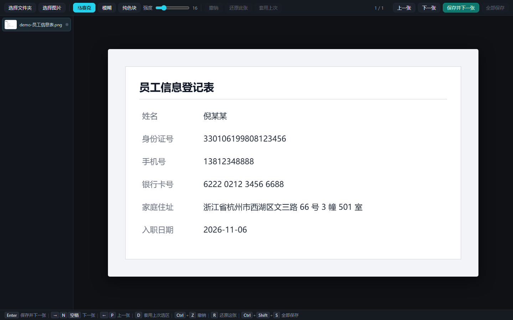

# 批量打码 · Mosaic Batch

浏览器里的批量图片打码工具：**一次导入整个文件夹 → 逐张拖框打码 → 直接覆盖原文件**，不用一张张另存、不用装软件。

马赛克 / 高斯模糊 / 纯色块三种模式，纯前端，图片一个字节都不会离开你的机器。



## 在线使用（零安装）

<https://YOUR-USER.github.io/mosaic-batch/>

用 Chrome / Edge 打开，点「选择文件夹」时浏览器会要求一次目录读写授权，允许后整个文件夹都能原地写回。

## 本地使用

双击 `本地启动.bat`（需要 Python 3），浏览器自动打开 `http://127.0.0.1:8788/`。

> 直接双击 `index.html` 也能用，但 `file://` 页面没有磁盘写权限，只能把结果下载成副本。

## 为什么本地版要起一个服务器

浏览器禁止 `file://` 页面改写磁盘文件，这是硬限制。本地起一个 `http.server` 后页面就处于 secure context，才能拿到 File System Access API 的写权限，用 `createWritable()` 覆盖原文件。

页面上传类工具做不到"覆盖原图"，只能让你下载 —— 这个工具的核心就是省掉那一步。

## 快捷键

| 键 | 作用 |
|---|---|
| 拖框 | 打码（模式与强度看顶部） |
| `Enter` | 保存并跳到下一张未保存的图 |
| `→` / `N` / `空格` / `PageDown` | 下一张 |
| `←` / `P` / `PageUp` | 上一张 |
| `D` | 把上一张的最后一块选区原样套到这一张 |
| `Ctrl+Z` | 撤销（可一路撤到底） |
| `R` | 还原这张（清空本张全部打码） |
| `Ctrl+Shift+S` | 全部保存 |
| `Esc` | 取消当前拖框 |

队列左侧的状态点：灰 = 没动，黄 = 改过没存，绿 = 已写回原文件。

`D` 是批量场景最省事的键：同版式的截图（同一张表、同一个界面）只框一次，之后每张 `D` + `Enter` 两下就完事。

## 打码强度

马赛克块 < 12px、模糊半径 < 10px 时，短文本（卡号后四位、验证码、PIN）有被 Depix / Unredacter 这类工具还原的先例 —— 原理是穷举候选字符、用同样参数打码后比对。

- 人脸、杂乱背景：马赛克 / 模糊都够
- 密码、密钥、证件号、卡号：用 **纯色块**

## 实现

- 单文件 `index.html`，零依赖，约 28 KB
- 打码记录为「区域 + 参数」的操作序列，撤销时重放，不存像素副本 —— 大图、几十步操作也不吃内存
- 解码后的位图只保留最近 3 张，切走即释放（4K 一张约 40 MB，不释放切几十张就爆）
- 保存成功后把内存里的「原图 + 操作」固化成「已打码结果」，避免它被移出缓存、再从磁盘读回来时把操作重放第二遍
- 画布双层：底层图像 + 上层选区预览，坐标按 `getBoundingClientRect` 换算，缩放不错位
- 全部处理在本地 Canvas 完成，无网络请求、无遥测
- 写回走 File System Access API；会丢失 EXIF（含 GPS），gif / bmp 这类 Canvas 不能编码的格式会转成 PNG 写回同名文件

## 兼容性

| 浏览器 | 能力 |
|---|---|
| Chrome / Edge 86+ | 完整：可导入文件夹、可覆盖原文件 |
| Safari / Firefox | 只能「选择图片」→ 下载副本 |

## 已知限制

- 一次只处理一个文件夹，不递归子目录
- 内存里只留最近 3 张解码位图，来回跳太远会重新解码（4K 图约 0.3~0.5 秒）
- 单张图超过浏览器 Canvas 上限（边长约 1.6 万像素）会失败，这种图先缩一下
- 写回会丢掉 EXIF / ICC / 动画帧；gif、bmp 这类 Canvas 不能编码的格式会转成 PNG 写回同名文件
- 没有 AI 自动识别，全靠手框

## 注意

覆盖不可逆。第一次用建议先备份一份目录：

```powershell
Copy-Item "D:\你的图" "D:\你的图_backup" -Recurse
```

## License

MIT
